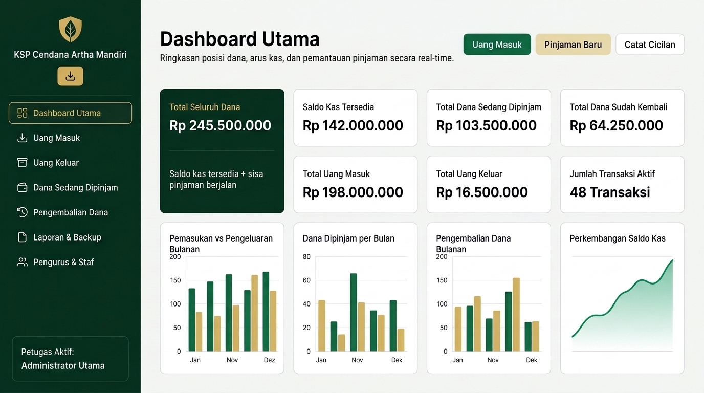

# Koperasi Simpan Pinjam Cendana Artha Mandiri

Aplikasi web manajemen keuangan, pembukuan kas, dan pemantauan simpan pinjam untuk **Koperasi Simpan Pinjam (KSP) Cendana Artha Mandiri**. Dirancang responsif untuk penggunaan nyaman di browser desktop, tablet, serta smartphone Android maupun iPhone/Safari dengan antarmuka berbahasa Indonesia, format mata uang **Rupiah (`Rp`)**, dan format tanggal **`DD/MM/YYYY`**.

---

## Preview Tampilan Dashboard



---

## Fitur Utama

### 1. Layar Pembuka Gelombang (`0% – 100%`), Instalasi Aplikasi (`KSP CAM`), & Manajemen Petugas
- **Akses Langsung Tanpa Login PIN / Tanpa Login Google:** Saat aplikasi dibuka, pengguna disambut layar pemuatan animasi gelombang progresif **0% hingga 100%** bertajuk **KOPERASI SIMPAN PINJAM ARTHA MANDIRI** sembari menyinkronkan data cloud secara langsung, lalu masuk otomatis ke Dashboard dengan transisi gelombang.
- **Dukungan Instalasi PWA (`KSP CAM`):** Aplikasi dapat diunduh langsung melalui tombol ikon unduh pada bilah navigasi untuk dipasang di layar utama Desktop, Android, maupun iPhone/iPad dengan nama **`KSP CAM`** beserta ikon resmi koperasi.
- **Pengurus & Staf Koperasi:** Pengurus dapat menambah, mengedit, menonaktifkan, menghapus, dan mengganti **Petugas Aktif** (Admin/Staf) kapan saja agar setiap transaksi dan cetakan laporan tercatat sesuai nama petugas yang bertugas.

### 2. Dashboard Utama (Perhitungan Real-Time)
Seluruh metrik dihitung otomatis langsung dari data transaksi nyata (tanpa data dummy permanen):
- **7 Kartu Ringkasan Keuangan:**
  1. Total Seluruh Dana (`Saldo Kas Tersedia + Total Dana Sedang Dipinjam`)
  2. Saldo Kas Tersedia
  3. Total Dana Sedang Dipinjam
  4. Total Dana Sudah Kembali
  5. Total Uang Masuk
  6. Total Uang Keluar
  7. Jumlah Transaksi Aktif
- **Pengingat Jatuh Tempo Prioritas:** Menampilkan daftar pinjaman yang sudah melewati jatuh tempo maupun mendekati H-7, H-3, dan H-1.
- **4 Grafik Visual Interaktif:**
  1. Pemasukan vs Pengeluaran Bulanan
  2. Dana Dipinjam per Bulan
  3. Pengembalian Dana Bulanan
  4. Perkembangan Saldo Kas

### 3. Uang Masuk & Uang Keluar
- Nomor transaksi dibuat otomatis (`KM-YYYYMMDD-001` untuk kas masuk, `KK-YYYYMMDD-001` untuk kas keluar).
- Input kategori transaksi, metode pembayaran (**Tunai** / **Transfer Bank**), nama penyetor/penerima, nominal Rupiah, dan uraian transaksi.
- Mendukung **lampiran bukti Foto (JPG/PNG/WebP — otomatis dikompresi) atau dokumen PDF (maks. 650 KB)** beserta pratinjau langsung di dalam aplikasi.
- Fitur pencarian, filter kategori, filter rentang tanggal, ubah data, serta hapus dengan dialog konfirmasi dan pembaruan saldo kas otomatis.

### 4. Dana Sedang Dipinjam
- Pencatatan pencairan pinjaman dengan nomor otomatis (`PJ-YYYYMMDD-001`), data peminjam, ID/NIK anggota, nomor HP/WhatsApp, tanggal pinjam, jatuh tempo, pokok pinjaman, jasa/admin, dan lampiran dokumen akad/identitas (Foto/PDF).
- **Status Warna Otomatis:**
  - `DIPINJAM` (Biru)
  - `DIBAYAR SEBAGIAN` (Kuning)
  - `LUNAS` (Hijau)
  - `TERLAMBAT` (Merah)
- **Pengingat Jatuh Tempo:** Otomatis mendeteksi **H-7**, **H-3**, **H-1**, dan **Terlambat** beserta tombol filter cepat.
- Klik baris pinjaman mana saja untuk membuka panel detail lengkap, progres pelunasan, dokumen lampiran, dan riwayat cicilan.

### 5. Pengembalian Dana
- Memilih nomor transaksi pinjaman aktif langsung memunculkan data peminjam, pokok pinjaman, total tagihan, riwayat cicilan sebelumnya, dan sisa tagihan secara otomatis.
- Mendukung **cicilan bertahap** maupun pelunasan penuh (`Bayar Sisa Penuh`).
- Nomor transaksi pengembalian otomatis (`PB-YYYYMMDD-001`) dengan opsi lampiran bukti pembayaran.
- Secara otomatis mengubah status pinjaman menjadi **`LUNAS`** saat sisa mencapai `Rp 0` dan menambah **Saldo Kas Tersedia**.

### 6. Laporan Keuangan, Database Terpadu & Backup
- **Filter Fleksibel:** Harian, Bulanan, Tahunan, Rentang Tanggal, dan Jenis Mutasi pada Buku Kas Terpadu.
- **Ekspor & Cetak:**
  - Ekspor **Excel (`.csv`)** dengan format UTF-8 BOM.
  - Ekspor **PDF (`.pdf`)** ber-kop resmi KSP Cendana Artha Mandiri.
  - **Cetak Langsung** melalui dialog cetak browser dengan tata letak kertas A4 dan blok tanda tangan pengurus.
- **Backup & Restore JSON:** Unduh seluruh database (transaksi, pinjaman, pengembalian, lampiran, dan daftar pengurus) dalam satu file `.json` serta pulihkan kembali dengan validasi dan konfirmasi.

---

## Teknologi & Database Cloud

- **Frontend:** React 19, TypeScript, Tailwind CSS v4, Lucide React
- **Database Cloud Real-Time:** **Firebase Cloud Firestore** (`firebase-applet-config.json` & aturan keamanan `firestore.rules`), sehingga seluruh data tersimpan persisten di cloud dan langsung tersinkronisasi real-time di berbagai perangkat (desktop, tablet, maupun HP).
- **Ekspor Dokumen:** jsPDF & jspdf-autotable
- **Build & Hosting:** Vite & Vercel (`vercel.json`)

---

## Cara Menjalankan di Lokal

1. **Instalasi dependensi:**
   ```bash
   npm install
   ```

2. **Menjalankan mode pengembangan:**
   ```bash
   npm run dev
   ```

3. **Build produksi:**
   ```bash
   npm run build
   ```

4. **Verifikasi tipe TypeScript & aturan keamanan Firestore:**
   ```bash
   npm run lint
   npx eslint firestore.rules
   ```

---

## Panduan Deploy ke Vercel

Karena frontend aplikasi terhubung langsung ke **Firebase Cloud Firestore** (`firebase-applet-config.json`) dengan sinkronisasi real-time, aplikasi siap di-deploy ke Vercel secara langsung tanpa perlu mengisi Environment Variables tambahan:

1. **Import proyek ke Vercel** dari repositori GitHub Anda (pastikan file `firebase-applet-config.json` ikut ada di repositori).
2. **Langsung klik Deploy:** Vercel akan membangun bundel produksi (`dist`) dan menyajikan aplikasi dengan routing SPA (`vercel.json`).

---

## Struktur Direktori Utama

```text
├── docs/
│   └── dashboard-preview.jpg          # Gambar preview tampilan Dashboard Utama
├── public/
│   ├── icon.svg                       # Logo vektor resmi KSP CAM
│   ├── pwa-192x192.png                # Ikon aplikasi PWA 192x192
│   ├── pwa-512x512.png                # Ikon aplikasi PWA 512x512
│   ├── pwa-maskable-512x512.png       # Ikon adaptif (maskable) Android
│   └── apple-touch-icon.png           # Ikon layar utama iPhone / iPad Safari
├── firebase-applet-config.json        # Konfigurasi proyek Firebase & Firestore database
├── firebase-blueprint.json            # Skema entitas & koleksi Firestore
├── firestore.rules                    # Aturan keamanan Firestore tervalidasi ESLint
├── vercel.json                        # Konfigurasi build & routing SPA Vercel
├── index.html                         # Entri HTML & metadata PWA KSP CAM
├── src/
│   ├── App.tsx                        # Root aplikasi, sinkronisasi real-time, & routing menu
│   ├── firebase.ts                    # Inisialisasi Firebase SDK & uji koneksi boot
│   ├── types.ts                       # Definisi tipe data transaksi, pinjaman, cicilan, & staf
│   ├── index.css                      # Konfigurasi Tailwind CSS v4, animasi gelombang, & gaya cetak
│   ├── hooks/
│   │   └── usePWAInstall.ts           # Hook deteksi instalasi PWA (KSP CAM) lintas perangkat
│   ├── services/
│   │   └── firestoreService.ts        # Operasi CRUD & listener real-time Firebase Firestore
│   ├── utils/
│   │   ├── format.ts                  # Format Rupiah, DD/MM/YYYY, penomoran otomatis, & kalkulasi real-time
│   │   └── export.ts                  # Utilitas ekspor Excel (.csv), PDF, & Backup JSON
│   └── components/
│       ├── BrandLogo.tsx              # Logo vektor KSP Cendana Artha Mandiri
│       ├── PWAInstallButton.tsx       # Tombol ikon unduh aplikasi KSP CAM
│       ├── WaveLoadingScreen.tsx      # Layar loading gelombang 0–100% KOPERASI SIMPAN PINJAM ARTHA MANDIRI
│       ├── Sidebar.tsx                # Sidebar desktop & menu lipat responsif untuk mobile
│       ├── DashboardView.tsx          # 7 kartu ringkasan, pengingat jatuh tempo, & 4 grafik visual
│       ├── CashTransactionsView.tsx   # Modul Uang Masuk & Uang Keluar
│       ├── LoansView.tsx              # Modul Dana Sedang Dipinjam & detail pinjaman
│       ├── RepaymentsView.tsx         # Modul Pengembalian Dana & cicilan bertahap
│       ├── ReportsBackupView.tsx      # Laporan keuangan, buku kas terpadu, ekspor, & backup/restore
│       ├── AccountsPinView.tsx        # Manajemen Pengurus & Staf serta petugas aktif
│       ├── AttachmentField.tsx        # Unggah & kompresi bukti Foto/PDF
│       ├── AttachmentViewerModal.tsx  # Pratinjau lampiran Foto/PDF
│       └── ConfirmModal.tsx           # Dialog konfirmasi aksi sensitif
```

---

## Profil Pengembang

**RioProjectX**

Aplikasi **Koperasi Simpan Pinjam Cendana Artha Mandiri** ini dirancang dan dikembangkan oleh **RioProjectX** sebagai solusi digitalisasi tata kelola keuangan koperasi yang bersih, akurat, transparan, dan tersinkronisasi di cloud untuk berbagai perangkat.

- **Pengembang:** RioProjectX
- **Fokus Pengembangan:** Sistem Informasi Keuangan, Integrasi Cloud Database, Aplikasi Web Responsif, & Sinkronisasi Data Real-Time
